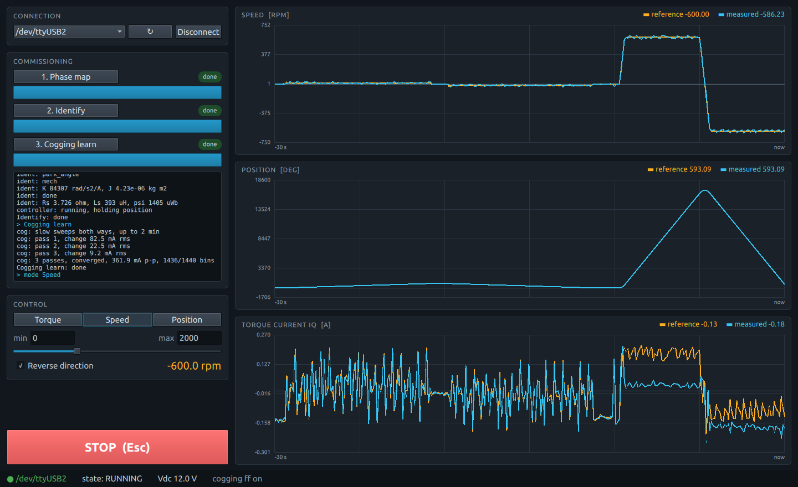
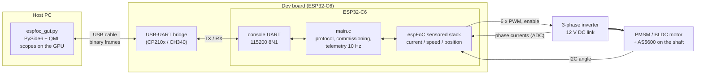

# foc_sensored_gui

Field-oriented control of a PMSM/BLDC motor with an AS5600 encoder, driven
from a desktop GUI. The board commissions the motor one step at a time when
you press the buttons, then follows the torque, speed or position reference
you set with a slider, while three scopes plot reference against measurement.



The GUI is a single Python file, [`host/espfoc_gui.py`](host/espfoc_gui.py):
PySide6 with the QML inline. The scopes are drawn as Qt Quick scene-graph
geometry, so the GPU does the drawing through Qt's RHI (OpenGL, Vulkan, Metal
or Direct3D, whatever the platform offers). The file is commented top to
bottom as a starting point for your own front end. The same file drives
[`foc_sensorless_gui`](../foc_sensorless_gui): it reads the board kind from
the `INFO` frame and shows the sensorless start-up panel instead of the
position controls.

## How the host connects to the board



There is no extra wiring for the GUI: it uses the same USB cable and UART that
`idf.py flash monitor` uses. Only one program can hold the port, so close any
serial monitor before starting the GUI. The GUI opens the port with DTR and
RTS released, so connecting does not reset the board.

## Using it

1. **Connect**: pick the board's serial port, press *Connect*. The board
   answers with its limits (pole pairs, slider ranges).
2. **Commission**, in order; a step unlocks once the one before it is done,
   a done step can run again, and the log under them shows what the board
   reports:
   1. *Phase map*: which bridge output drives which phase, current signs,
      encoder zero and direction (~4 s).
   2. *Identify*: resistance, inductance, flux, acceleration per amp, inertia,
      encoder offset and delay (~90 s, the shaft spins). The controller is
      then designed from these numbers and starts, holding position.
   3. *Cogging learn*: slow sweeps both ways map the magnets' pull at every
      shaft angle (~80 s). The controller cancels it from then on. Where the
      shaft stops becomes 0 deg.
3. **Drive**: choose *Torque* (A), *Speed* (rpm) or *Position* (deg). Set the
   slider's *min* and *max*, move the slider; *Reverse direction* flips the
   sign of the reference. Torque and speed start at 0; position starts
   where the shaft is, so changing mode never makes the shaft jump. Entering
   position takes off the whole turns speed or torque added, so the angle is
   back within half a turn of 0 deg, the same shaft point as before.
4. **STOP** (or *Esc*) turns the bridge off. Selecting a mode afterwards
   starts the controller again; commissioning is kept. STOP also clears an
   abort or fault (overspeed, current trip, encoder lost). Phase map and
   identification cannot be interrupted half way: STOP during them reboots
   the board, with the bridge held off across the reset.

### Commissioning across reboots

With **Keep the commissioning results across reboots (NVS)** on (the
default, `CONFIG_EXAMPLE_GUI_PERSIST`), each step saves its result to NVS
when it finishes: the phase map with the encoder zero and direction, the
identified plant, the cogging table. On boot the board applies them in order
and logs `nvs: saved commissioning found, restoring`, one
`nvs: <step> restored` per step, and on every connect
`nvs: running on saved commissioning: map ident cog; any step can run again`.
With all three back it is ready to drive; pick a mode.

- **Running a step again** discards it and every step after it, in NVS too:
  a new phase map needs a new identification and cogging learn, a new
  identification a new cogging learn.
- **A saved step is discarded** when it is corrupt, from another firmware
  format, or when the board configuration it was taken with changed (pins,
  pole pairs, DC link, PWM, shunt, gain, encoder bus, cogging bins). The log
  says which and why, and that step and the ones after it run again.
- **Not detected:** a motor swapped for another of the same configuration,
  or an encoder magnet remounted. Run the phase map again after either.
- Saving writes flash, so the bridge is off while a step is saved; after a
  cogging learn the controller stops for that moment and starts again.

With the option off, nothing is saved and every boot starts at step 1.

The board clamps every reference to the ranges in `menuconfig`
(**espFoC example: sensored GUI → GUI limits**), whatever the host sends:
±2000 rpm, ±0.5 A, ±3600 deg by default. The overspeed trip (2900 rpm)
protects torque mode, where an unloaded shaft keeps speeding up.

## Getting started

### Board

Same bench as the other sensored examples:

| Signal                         | Bench GPIO    | Direction        |
|--------------------------------|---------------|------------------|
| PWM phase U high / low side    | 18 / 19       | chip → inverter  |
| PWM phase V high / low side    | 20 / 21       | chip → inverter  |
| PWM phase W high / low side    | 22 / 23       | chip → inverter  |
| Bridge enable (active low)     | 15            | chip → inverter  |
| Current sense U (ADC)          | 5             | inverter → chip  |
| Current sense V (ADC)          | 4             | inverter → chip  |
| Current sense W                | not wired     | (two shunts)     |
| AS5600 SDA (I²C, 400 kHz)      | 2             | bidirectional    |
| AS5600 SCL                     | 3             | chip → encoder   |
| GND                            | GND           | common to all    |

Pins, dead time, shunt, gain, pole pairs, DC link and the GUI limits are in
`idf.py menuconfig` under **espFoC example: sensored GUI**.

### Build and flash

With ESP-IDF v5.5 installed:

```bash
. $IDF_PATH/export.sh
cd examples/foc_sensored_gui
idf.py -p /dev/ttyUSB0 flash
```

The target comes from `sdkconfig.defaults` (`esp32c6`). For another supported
chip, run `idf.py set-target <target>` first and set its pins.

### Run the GUI

```bash
pip install PySide6 pyserial
python3 host/espfoc_gui.py --port /dev/ttyUSB0
```

`--port` is optional; without it, pick the port in the window.

## Protocol

Binary frames over the console UART, 115200 8N1:

```text
+------+------+-----+-----------------+-------+
| 0xA5 | type | len | payload[len]    | crc8  |
+------+------+-----+-----------------+-------+
                     len <= 64          over type, len, payload
```

- CRC-8: polynomial `0x07`, initial value `0`, no reflection.
- Little endian; `f32` is IEEE-754 single precision.
- A receiver skips bytes until a `0xA5` that starts a frame with a good CRC.
  This is how the GUI steps over the ROM and bootloader text at boot, which
  it shows in its log as `[boot]` lines.

### Host → board

| Type   | Name    | Payload     | Effect |
|--------|---------|-------------|--------|
| `0x01` | `PING`  | –           | board answers `INFO` |
| `0x02` | `MAP`   | –           | start phase discovery |
| `0x03` | `IDENT` | –           | start identification, then start the controller |
| `0x04` | `COG`   | –           | start cogging learn |
| `0x05` | `MODE`  | `u8` mode   | 0 torque, 1 speed, 2 position; starts the controller if it is stopped |
| `0x06` | `REF`   | `f32` value | reference in the unit of the mode: A, rpm, deg |
| `0x07` | `STOP`  | –           | bridge off (reboot during map / identify) |

Every command but `PING` is answered with an `ACK`. `MAP`, `IDENT`, `COG`
and a `MODE` that restarts the controller answer when the step ends, which
can take minutes; the others answer at once. A command out of order (for
example `IDENT` before `MAP`) is refused with `ESP_ERR_INVALID_STATE`.

### Board → host

| Type   | Name   | Payload | When |
|--------|--------|---------|------|
| `0x81` | `INFO` | `u8` pole pairs, `f32` max rpm, `f32` max iq [A], `f32` max deg | boot, `PING` |
| `0x82` | `TEL`  | see below, 35 bytes | every 100 ms |
| `0x83` | `PROG` | `u8` step (0 map, 1 identify, 2 cogging), `u8` percent (`0xFF` unknown) | during a step |
| `0x84` | `LOG`  | text, not terminated | the board's log, one line per frame (split if longer than 64) |
| `0x85` | `ACK`  | `u8` command, `i32` `esp_err_t` (0 = OK) | after a command |

`TEL` payload:

| Offset | Type  | Field |
|--------|-------|-------|
| 0      | `u8`  | steps done: bit 0 map, bit 1 identify, bit 2 cogging |
| 1      | `u8`  | busy: 0 no, 1 map, 2 identify, 3 cogging, 4 starting |
| 2      | `u8`  | controller state: 0 idle, 1 armed, 2 running, 3 learning, 4 fault |
| 3      | `u8`  | mode: 0 torque, 1 speed, 2 position |
| 4      | `u8`  | flags: bit 0 running, 1 abort, 2 fault, 3 in position, 4 cogging compensation on |
| 5      | `f32` | speed reference [rpm] |
| 9      | `f32` | speed [rpm] |
| 13     | `f32` | position reference [deg] |
| 17     | `f32` | position [deg] |
| 21     | `f32` | iq reference [A] |
| 25     | `f32` | iq [A] |
| 29     | `f32` | DC link [V] |
| 33     | –     | 2 bytes reserved |

Everything the GUI shows comes from `TEL`: it does not track the sequence
itself, so after a reconnect or a board reboot it simply shows what the board
reports.

### Sensorless boards

[`foc_sensorless_gui`](../foc_sensorless_gui) speaks the same protocol with
these differences:

- `INFO` is 22 bytes: the 13 above, then `u8` kind (1 = sensorless), `f32`
  minimum rpm, `f32` minimum iq [A]. Under those the observer cannot hold the
  rotor; a 13-byte `INFO` is a sensored board.
- Commissioning is map and identify only: `COG` answers
  `ESP_ERR_NOT_SUPPORTED`, steps done reaches `0b011`. `MODE` takes 0 torque
  or 1 speed, only while the motor is stopped.
- `REF` only stores the reference until the motor is started:

  | Type   | Name    | Payload | Effect |
  |--------|---------|---------|--------|
  | `0x08` | `START` | –       | launch with the stored reference; refused with `ESP_ERR_INVALID_ARG` under the minimum |

  After `START`, a `REF` under the minimum cuts the bridge and one above
  launches again; a sign change reverses. `STOP` cuts the bridge and clears
  any trip; the next launch needs `START` again.
- `TEL` state is the sensorless controller state: 0 idle, 1 armed, 2 align,
  3 I-f ramp, 4 PLL acquire, 5 handoff, 6 catch, 7 running, 8 reversing,
  9 fault. Flags: bit 0 running, 1 abort, 2 fault, 3 observer locked,
  4 Park on the observer, 5 start-up failed, 6 started. The position fields
  are 0.
- One `STARTUP` frame per controller event:

  | Type   | Name      | Payload |
  |--------|-----------|---------|
  | `0x86` | `STARTUP` | 17 bytes, below |

  | Offset | Type  | Field |
  |--------|-------|-------|
  | 0      | `u8`  | event: 0 armed, 1 start-up, 2 locked, 3 handoff, 4 running, 5 reversing, 6 cut, 7 stopped, 8 start-up failed, 9 abort, 10 fault, 11 fault cleared |
  | 1      | `u8`  | controller state at the event |
  | 2      | `u8`  | start-up failure: 0 none, 1 enable refused, 2 sequence refused, 3 no current, 4 shaft not following, 5 PLL timeout, 6 speed low after handoff, 7 speed drop while settling |
  | 3      | `u8`  | abort: 0 none, 1 lock lost, 2 overspeed, 3 back-EMF low, 4 current collapse |
  | 4      | `u8`  | inverter fault reason, 0 none |
  | 5      | `f32` | observer speed [rpm] |
  | 9      | `f32` | observer minus open-loop angle [deg] |
  | 13     | `f32` | seconds since the start-up began |
