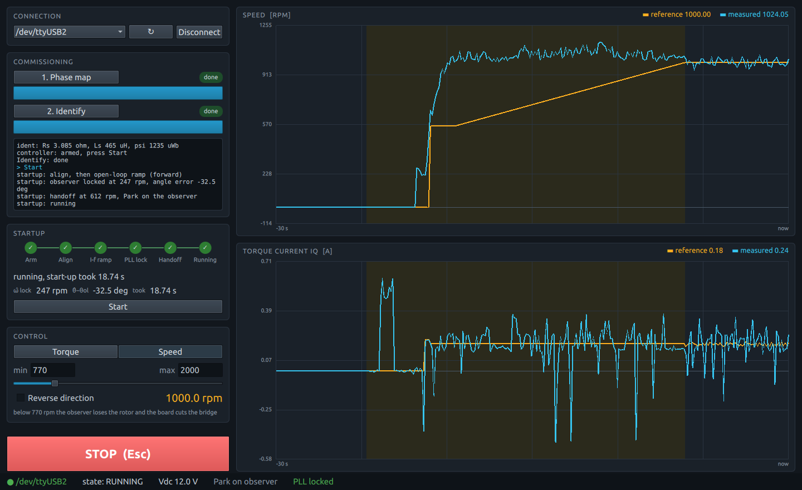

# foc_sensorless_gui

Sensorless field-oriented control of a PMSM/BLDC motor, driven from a desktop
GUI. There is no rotor sensor: the angle comes from the back-EMF observer.
The board commissions the motor when you press the buttons, launches it
through its open-loop start-up when you press *Start*, then follows the
torque or speed reference you set with a slider.



The host program is the same single file as the sensored example,
[`../foc_sensored_gui/host/espfoc_gui.py`](../foc_sensored_gui/host/espfoc_gui.py).
It reads the board kind from the `INFO` frame and reshapes the window:

- Commissioning has two steps, *Phase map* and *Identify*. There is no
  cogging learn: without an encoder there is no shaft angle to map it on.
- A **Startup** panel shows where the start-up got to: *Arm → Align →
  I-f ramp → PLL lock → Handoff → Running*. A failed start-up turns its node
  red with the reason. Under it: the observer speed and its angle error
  against the open-loop angle when the PLL locked, and how long the start-up
  took. *Start* launches the motor.
- *Torque* and *Speed* modes only. The slider starts at the observer's
  minimum; below it the board cuts the bridge.
- Two scopes, speed and iq. The start-up window (align to catch, and any
  reversal) is shaded.

## How the host connects to the board

The same as the sensored example (see its
[README](../foc_sensored_gui/README.md#how-the-host-connects-to-the-board)),
without the AS5600: the motor has only its three phase wires to the inverter.

## Using it

1. **Connect**: pick the board's serial port, press *Connect*.
2. **Commission**, in order (a done step can run again):
   1. *Phase map*: which bridge output drives which phase and the current
      signs, from currents only (~3 s).
   2. *Identify*: resistance, inductance and flux (~20 s, the shaft spins).
      The controller is designed from these numbers and armed.
3. **Start**: choose the mode while the motor is stopped, set the slider at
   or above the minimum (770 rpm / 0.20 A by default), press *Start*. The
   board aligns the rotor, ramps it open-loop until the observer locks, hands
   Park over to the observer and catches the reference. In speed mode the
   catch runs at the controller's start-up rate, so reaching 1000 rpm takes
   about 20 s; once *Running*, the slider moves the reference at the GUI
   rate (500 rpm/s).
4. **Drive**: move the slider. *Reverse direction* flips the sign: the board
   slows down, coasts, and launches again the other way. Moving the slider
   under the minimum cuts the bridge; the motor launches again when it comes
   back above.
5. **STOP** (or *Esc*) cuts the bridge and arms the controller again; press
   *Start* for the next launch. STOP also clears a failed start-up, an abort
   (observer lock lost, overspeed, back-EMF too low) or an inverter fault.
   During phase map and identification it reboots the board instead.

The mode is part of the controller's design, so it changes only while the
motor is stopped. The board clamps every reference to the ranges in
`menuconfig` (**espFoC example: sensorless GUI → GUI limits**). The overspeed
abort (1.25 × the rated 2300 rpm) protects torque mode, where an unloaded
shaft keeps speeding up.

### Commissioning across reboots

With **Keep the commissioning results across reboots (NVS)** on (the
default, `CONFIG_EXAMPLE_GUI_PERSIST`), the phase map and the identified
plant are saved to NVS when each step finishes and applied again on boot,
which ends armed: set a reference and press *Start*. The log reads
`nvs: saved commissioning found, restoring`, then `nvs: <step> restored`,
and on every connect `nvs: running on saved commissioning: map ident`.

Running the phase map again discards the identification too. A saved step
that is corrupt, from another firmware format or taken with a different
board configuration (pins, pole pairs, DC link, PWM, shunt, gain) is
discarded with a log line saying why, and runs again. A different motor of
the same configuration is not detected; commission it again.

## Getting started

### Board

The sensored bench without the encoder:

| Signal                         | Bench GPIO    | Direction        |
|--------------------------------|---------------|------------------|
| PWM phase U high / low side    | 18 / 19       | chip → inverter  |
| PWM phase V high / low side    | 20 / 21       | chip → inverter  |
| PWM phase W high / low side    | 22 / 23       | chip → inverter  |
| Bridge enable (active low)     | 15            | chip → inverter  |
| Current sense U (ADC)          | 5             | inverter → chip  |
| Current sense V (ADC)          | 4             | inverter → chip  |
| Current sense W                | not wired     | (two shunts)     |
| GND                            | GND           | common to all    |

Pins, dead time, shunt, gain, pole pairs, DC link, rated speed and the GUI
limits are in `idf.py menuconfig` under **espFoC example: sensorless GUI**.

### Build and flash

```bash
. $IDF_PATH/export.sh
cd examples/foc_sensorless_gui
idf.py -p /dev/ttyUSB0 flash
```

### Run the GUI

```bash
pip install PySide6 pyserial
python3 ../foc_sensored_gui/host/espfoc_gui.py --port /dev/ttyUSB0
```

## Protocol

The sensored example's protocol, documented in its
[README](../foc_sensored_gui/README.md#protocol), with the sensorless
additions listed there: `INFO` carries the board kind and the minimum
references, `START` (`0x08`) launches the motor, `STARTUP` (`0x86`) reports
every controller event, and `TEL` carries the sensorless controller state
and flags.
